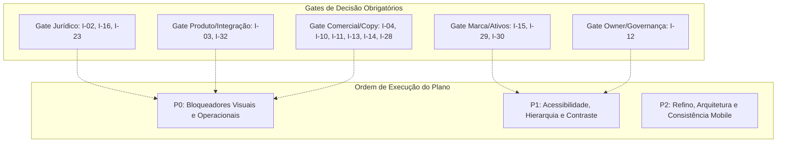
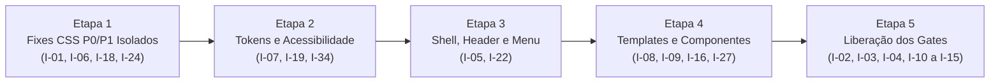

# Plano de Melhoria: Páginas Institucionais e de Conversão

| Metadado | Registro |
|---|---|
| Projeto | Site Institucional Telefonia Fácil (`2bx-systems/telefoniafacil`) |
| Documento de Origem | `docs/visual-audit-20261105/institutional.md` (Auditoria Visual Independente, 34 achados) |
| Relatórios Conexos | `docs/visual-audit-20261105/home.md` e `docs/visual-audit-20261105/products.md` |
| Versão de Referência | Branch `feat/homepage-content-v2-draft`, HEAD `5c8cc8b` com alterações locais de baseline |
| Responsável | Worker Antigravity — Orca Task `task_d2d2099881d6`, Dispatch `ctx_54186c267240` |
| Coordenador | Terminal `term_ed80fe48-2439-45f4-8ec6-8898c35e988c` |
| Data | 2026-11-05 |
| Estado de Governança | **Planejado — Documento de Proposta e Planejamento**. Nenhum código foi modificado; nenhum texto legal, comercial ou factual foi alterado; nenhum destino de CTA foi desviado; compras permanecem desativadas; nenhum teste, build, commit, push ou deploy foi executado. Não declara aprovação de produto. |

---

## 1. Contexto e Diretrizes do Plano

Este plano estabelece a estratégia técnica e operacional para sanar os **34 achados visuais e comportamentais (I-01 a I-34)** reportados na auditoria independente das 15 rotas institucionais e de conversão do Site Institucional:
- **Transição e Contratação Desativada:** `/carrinho/`, `/checkout/`, `/compras/`, `/contratar/`
- **Hub e Conversão Ativa:** `/solucoes/`, `/contato/`, `/suporte/`
- **Prova Social e Conteúdo:** `/cases/`, `/conteudos/`
- **Institucionais Primárias e Secundárias:** `/sobre/`, `/seguranca/`, `/parceiros/`, `/trabalhe-conosco/`
- **Páginas Legais:** `/politica-de-privacidade/`, `/termos-de-uso/`

### 1.1 Princípios Inegociáveis de Execução
1. **Preservação de Escopo do Repositório:** Este repositório é restrito ao **Site Institucional**. As rotas `/compras/`, `/carrinho/`, `/checkout/` e `/contratar/` são exclusivamente superfícies informativas de transição institucional que comunicam a desativação do fluxo antigo e orientam o contato consultivo. Não implementar lógica de carrinho, checkout, gateway de pagamento, cálculo de frete ou pedidos transacionais neste projeto (pertencentes ao workspace isolado da Página de Compras).
2. **Separação Rígida entre Design e Conteúdo (Gates):** Proibições explícitas de inventar casos de clientes, depoimentos, certificações de segurança, cargos/vagas, endereços, razões sociais, regras jurídicas ou mensagens de marketing. Questões de conteúdo e modelo de negócio são isoladas em **Gates Obrigatórios**, cuja deliberação formal cabe aos owners humanos (Atlas, Coordenador, Jurídico, Comercial, Marca).
3. **Não-Regressão em Shell e Tokens Compartilhados:** `assets/css/site.css` e `assets/js/site.js` servem simultaneamente a Home (`/`), as 12 páginas de produtos e soluções (`/pabx/`, `/0800/`, etc.) e as 15 rotas institucionais. As alterações propostas são planejadas com isolamento por seletores de escopo (`data-family`, classes locais ou seletores estruturais) para não colidir com correções da Home (ex.: `home-promo.css`, hero B2B) nem com páginas de produto (ex.: cards de planos, componentes de preço).

---

## 2. Matriz de Gates de Decisão (Bloqueios Prévios)

Nenhum desenvolvedor ou agente deve implementar código para os itens marcados como **[Gate]** antes do registro formal da respectiva decisão pelo aprovador competente.



| Gate | IDs Vinculados | Questão Central a Decidir | Aprovador Responsável | Ação Técnica Autorizada Pós-Decisão |
|---|---|---|---|---|
| **Jurídico** | I-02, I-16, I-23 | 1. Fornecimento do texto integral homologado para Política de Privacidade e Termos de Uso.<br>2. Autorização de redação para consentimento LGPD no formulário.<br>3. Fornecimento de dados societários formais (Razão Social, CNPJ, endereço). | Diretor Jurídico / DPO | Inserir texto oficial com diagramação legal (coluna de 68ch, vigência, índice âncora, numeração). |
| **Produto / Integração** | I-03, I-32 | 1. Definição do destino da conversão em `/contato/`: manter protocolo `mailto:` assistido ou integrar API de CRM/webhook de mensageria.<br>2. Se `mailto:`, validar UX de acionamento do cliente de e-mail.<br>3. Política de indexação e canonical para rotas de transição. | Product Manager / Tech Lead | Ajustar manipulador de submit em `site.js:478`, adicionar estados `role="status"`/`aria-live` e feedback de envio. |
| **Comercial & Copy** | I-04, I-10, I-11, I-13, I-14, I-28 | 1. Papel do link de compras durante o período de desativação: manter texto secundário no header ou unificar no contato.<br>2. Canal de recepção de parceiros em `/parceiros/`.<br>3. Canal de candidatura em `/trabalhe-conosco/`.<br>4. O que pode ser afirmado institucionalmente sobre os clientes em `/cases/`.<br>5. Propósito editorial de `/conteudos/`.<br>6. Roteamento de necessidades em `/solucoes/`. | Head Comercial / Copywriter | Remover autolinks redundantes, alinhar CTAs ao canal definido e ajustar títulos/rótulos sem inventar fatos. |
| **Marca & Ativos** | I-15, I-29, I-30 | 1. Disponibilização de arquivos vetoriais (SVG) ou PNG 2x nítidos dos 8 logos de clientes autorizados.<br>2. Direção de arte para substituição de imagens de banco sintetizadas com arco verde.<br>3. Validação do alt text e identificação de especialistas em `/sobre/`.<br>4. Aprovação de novos glifos de ícones semânticos. | Brand Designer / Diretor de Arte | Substituição de assets em `assets/images/clients/` e `assets/images/`, padronização óptica e remoção de claims nos alts. |
| **Owner / Governança** | I-12 | Decisão sobre o ciclo de vida das 3 páginas órfãs (`/parceiros/`, `/trabalhe-conosco/`, `/seguranca/`): publicar formalmente com link no rodapé ou retirar do `sitemap.xml`. | Atlas / Sponsor do Projeto | Inclusão de links na seção Institucional do rodapé ou remoção das entradas no XML do sitemap. |

---

## 3. Plano Detalhado dos 34 Achados

Cada achado é catalogado com sua evidência visual das pastas de captura (`out/` e `out2/`), arquivo e seletor exato, proposta de alteração técnica, critérios de aceite em Desktop e Mobile, estimativa de esforço e dependências.

### 3.1 Achados P0 — Bloqueadores Críticos (Antes de Qualquer Aceite Visual)

#### [I-01] Colisão do H1 sobre a foto do Hero em `/sobre/`
- **Gravidade:** Crítica
- **Evidência Visual:** `out/sobre.desktop.fold.png`, `out/sobre.desktop.full.png`, `out2/sobre.1024.fold.png`, `out2/sobre.1280.fold.png`, `out2/sobre.1440.fold.png`, `out2/sobre.1920.fold.png`.
- **Diagnóstico:** Em `assets/css/site.css:691`, `.family-hero-photo` declara `left: 53%`. Na media query de desktop em `site.css:951`, declara `right: 0` e `width: max(420px, calc((100vw - 1180px)/2 + 460px))`, mas omite `left: auto`. Pela regra de cascata do CSS em posicionamento absoluto, quando `left` e `width` estão ativos, a propriedade `right` é descartada pelo motor de renderização. Em 1440px, a foto inicia em x763 enquanto o H1 avança até x808, gerando sobreposição de 45px e deixando 87px de faixa branca inútil à direita (x1353 a 1440).
- **Mudança Técnica:** Em `assets/css/site.css:951`, adicionar explicitamente `left: auto !important;` à regra de `.family-hero-photo`. (Testado em memória com sucesso em 9 larguras: 981px a 1920px).
- **Critérios de Aceite:**
  - *Desktop (1920, 1536, 1440, 1366, 1280, 1121, 1100, 1024, 981):* A foto do hero fica fixada na borda direita da viewport (`right: 0`), o H1 e o subtítulo têm folga horizontal mínima de 38px em relação à imagem, e a faixa branca residual é completamente eliminada.
  - *Mobile:* Hero renderiza de forma limpa, sem overflow horizontal (`scrollWidth == clientWidth`).
- **Esforço / Risco:** P (15 min) / Risco Nulo (afeta apenas layout da família `manifesto` no desktop).

#### [I-02] Exposição de instruções internas de rascunho nas páginas legais (`/politica-de-privacidade/`, `/termos-de-uso/`)
- **Gravidade:** Crítica [Gate Jurídico]
- **Evidência Visual:** `out/politica-de-privacidade.desktop.fold.png`, `out/politica-de-privacidade.mobile.fold.png`, `out/termos-de-uso.desktop.fold.png`, `out/termos-de-uso.mobile.fold.png`.
- **Diagnóstico:** As rotas publicam frases operacionais de desenvolvimento ("Página institucional preparada para receber o texto jurídico oficial..." e "O conteúdo jurídico final deve ser validado pela empresa antes da publicação.") em `assets/js/site.js:100-101`, enquanto o site coleta ativamente dados de pessoas físicas e jurídicas em `/contato/`.
- **Mudança Técnica:**
  1. Aguardar homologação do texto formal pelo Gate Jurídico.
  2. Implementar template dedicado para a família `legal` em `assets/js/site.js` substituindo a chamada genérica `generic()`.
  3. Diagramar em coluna contida (`max-width: 72ch; margin-inline: auto`), com data de versão/vigência, índice de âncoras para seções e cabeçalhos ordenados (H2 e H3).
  4. Remover o card decorativo com ícone de escudo e a nota de rascunho.
- **Critérios de Aceite:**
  - *Desktop:* Apresentação formal de leitura contínua, tipografia sóbria em tamanho legível (15-16px, line-height 1.6), sumário funcional por âncoras no topo.
  - *Mobile:* Texto perfeitamente responsivo, alinhamento à esquerda, espaçamento confortável entre cláusulas, ausência de banners promocionais intrusivos.
- **Esforço / Risco:** M (2h de desenvolvimento após texto aprovado) / Dependência Total do Gate Jurídico.

#### [I-03] Formulário de `/contato/` gera 0 requisições e oculta canal ativo em link micro de 12px
- **Gravidade:** Crítica [Gate Produto / Integração]
- **Evidência Visual:** `out2/form.after.d.png`, `out2/form.after.m.png`, `out2/nojs.contato.png`.
- **Diagnóstico:** Em `assets/js/site.js:478`, o manipulador de `submit` do `#contactForm` executa `e.preventDefault()`, monta strings para `mailto:` e injeta HTML dentro de `#contactNotice` com texto de 12px. Nenhuma requisição HTTP de rede é disparada (0 requests confirmados no log de CDP). O botão verde primário "Preparar contato" continua exibido com peso visual dominante, gerando falsa percepção de envio para o usuário comum. O elemento `#contactNotice` carece de atributos `role="status"` e `aria-live`.
- **Mudança Técnica:**
  - *Cenário A (Se mantido mailto assistido):* No evento de submit, alterar dinamicamente o botão primário para "Abrir no meu aplicativo de e-mail" (`<a>` estilizado como `.btn-primary` com o `href="mailto:..."` compilado), transformar o `#contactNotice` em caixa de status acessível (`role="status"`, `aria-live="polite"`, contraste >= 4.5:1, fonte 14px) explicando que o rascunho foi preparado no cliente.
  - *Cenário B (Se integrado a API de CRM/Backend via Gate de Produto):* Enviar payload via `fetch` assíncrono para o endpoint autenticado, desabilitar campos durante submissão, exibir estado de loading e trocar a visualização do card por mensagem de sucesso confirmada ("Mensagem recebida, retornaremos em até X horas").
- **Critérios de Aceite:**
  - *Desktop:* Submissão do formulário gera transição de estado visual inequívoca; leitores de tela anunciam o resultado via `aria-live`; o botão dominante reflete a ação real do próximo passo.
  - *Mobile:* Notificação e botão de envio permanecem no campo de visão imediato do usuário (auto-scroll se necessário); foco via teclado é transferido para a mensagem de status.
- **Esforço / Risco:** M (3h) / Dependência do Gate de Produto para escolha do modelo de integração.

#### [I-04] Predominância de CTAs para `/compras/` com destino desativado
- **Gravidade:** Alta [Gate Copy / Comercial]
- **Evidência Visual:** `out/cases.desktop.full.png`, `out/conteudos.desktop.full.png`, `out/sobre.desktop.full.png`, todas as capturas de topo `*.desktop.fold.png`.
- **Diagnóstico:** O botão verde primário de maior peso visual no header de todas as 15 rotas ("Acessar Página de Compras", x1067 a x1310) direciona para `/compras/`, que exibe aviso de compras desativadas. Em `/cases/`, ocorrem 9 links no corpo para `/compras/` contra 1 para `/contato/`. Em `/conteudos/` e `/sobre/`, botões primários direcionam para a transição. Nas 4 rotas de transição, o header apresenta autolinks confusos para a própria tela.
- **Mudança Técnica:**
  1. Header: Ajustar a hierarquia visual. O botão primário verde do header deve conduzir ao canal funcional ativo de conversão ("Fale com um especialista" -> `/contato/`). A referência à página de compras desativada é rebaixada para link textual secundário ou mantida em conformidade com o Gate de Copy.
  2. Corpo das páginas institucionais: Substituir os links e botões dispersos que apontam para `purchaseHref()` por links coerentes para `/contato/` ou para os produtos correspondentes, limitando a 1 CTA primário por seção.
  3. Em `/compras/` e telas irmãs de transição: Identificar visualmente a página atual e desativar o botão autorreferente no header.
- **Critérios de Aceite:**
  - *Desktop:* O CTA de destaque máximo em todas as telas convida para o canal comercial ativo (`/contato/`); nenhuma seção corporativa contém enxurrada de links para telas de aviso de transição.
  - *Mobile:* Menu mobile e viewport inicial apresentam caminho coerente sem contradições comerciais.
- **Esforço / Risco:** M (3h) / Dependência do Gate Comercial & Copy.

#### [I-05] Menu mobile e tablet (<= 1120px) oculta Contato e Suporte
- **Gravidade:** Alta
- **Evidência Visual:** `out2/menu.mobile.png`, `out/contato.mobile.fold.png`, `out/suporte.mobile.fold.png`.
- **Diagnóstico:** Quando a viewport atinge <= 1120px, a `.topbar` (que continha telefone e e-mail) é ocultada via `site.css:37`. O `.mobile-menu` gerado em `site.js:28` contém 14 links, porém **nenhum** para `/contato/` ou `/suporte/`. A única forma de um usuário mobile acessar o suporte ou telefone corporativo é rolar até o rodapé (y8329 na home ou y5713 em soluções).
- **Mudança Técnica:** Em `assets/js/site.js:28` (`header()`), reestruturar o `.mobile-menu`:
  1. Adicionar links diretos e destacados para "Contato" (`${href('contato')}`) e "Suporte" (`${href('suporte')}`).
  2. Incluir atalho rápido para discagem direta (`tel:+551931994699`).
  3. Transformar o grupo de 8 produtos em um acordeão recolhível por padrão, liberando altura óptica e evitando que o menu ocupe mais do que os 770px visíveis.
- **Critérios de Aceite:**
  - *Mobile / Tablet (320px a 1120px):* Ao tocar no hambúrguer, as opções "Contato", "Suporte" e o telefone corporativo estão visíveis na primeira tela do menu aberto sem rolagem; alvos de toque >= 44px.
  - *Desktop (>1120px):* Inalterado.
- **Esforço / Risco:** M (2h) / Baixo risco de regressão.

---

### 3.2 Achados P1 — Acessibilidade, Hierarquia e Contraste (Baixo Risco / Alto Impacto)

#### [I-06] Indicador de foco invisível no botão hambúrguer mobile
- **Gravidade:** Alta
- **Evidência Visual:** `out2/menu.mobile.png`, `assets/css/site.css:440` e `site.css:916-917`.
- **Diagnóstico:** `.hamb` possui regras destrutivas: `outline: 0 !important; box-shadow: none !important;` tanto na definição base quanto nos estados `:focus` e `:focus-visible`. Um usuário navegando via teclado em telas estreitas (<=1120px) não tem qualquer retorno visual ao focar o controle do menu.
- **Mudança Técnica:** Remover `outline: 0 !important;` e `box-shadow: none !important;` de `site.css:440` e `site.css:916-917`. Manter ativa a regra global de `site.css:117` (`:focus-visible { outline: 3px solid var(--focus-ring); outline-offset: 3px; }`).
- **Critérios de Aceite:**
  - *Desktop e Mobile:* Ao tabular até o botão hambúrguer, renderiza-se anel de foco verde visível com 3px de largura e 3px de respiro exterior.
- **Esforço / Risco:** P (10 min) / Risco Nulo.

#### [I-07] Texto de ação em verde `#0ca862` e texto secundário abaixo do contraste WCAG AA
- **Gravidade:** Alta
- **Evidência Visual:** `out/cases.desktop.full.png`, `out/conteudos.desktop.full.png`, `out/solucoes.desktop.full.png`.
- **Diagnóstico:** O tom verde `#0ca862` utilizado como texto em `assets/css/site.css` (linhas 20, 121, 131, 133, 314) apresenta taxa de contraste de 3,09:1 sobre fundo branco e 2,87:1 sobre fundo cinza-azulado `#f3f7fa`. O token de texto atenuado `--tf-muted: #617586` sobre `#f3f7fa` atinge 4,43:1 (abaixo do limiar de 4,5:1).
- **Mudança Técnica:**
  1. Em `assets/css/site.css`, substituir `#0ca862` em elementos textuais pelo token institucional `--tf-green-ink: #0a7a4c`, garantindo contraste de 5,38:1 em `#ffffff` e 5,00:1 em `#f3f7fa`.
  2. Ajustar a variável global `--tf-muted` de `#617586` para `#5a6e7f`, elevando o contraste para 4,91:1 sobre `#f3f7fa` e 4,76:1 sobre o fundo menta `#e9f6f1`.
- **Critérios de Aceite:**
  - *Desktop e Mobile:* Todos os links textuais ("Quero uma solução assim", "Conhecer solução", títulos de cartões) e parágrafos de apoio alcançam conformidade estrita com WCAG 2.1 AA (mínimo 4,5:1 para texto normal).
- **Esforço / Risco:** P (30 min) / Baixo risco.

#### [I-08] Inversão de hierarquia visual nos cartões do catálogo de `/solucoes/`
- **Gravidade:** Alta
- **Evidência Visual:** `out/solucoes.desktop.fold.png`, `out/solucoes.desktop.full.png`, `out2/focus.solucoes.20.png`.
- **Diagnóstico:** O título do produto nos cartões `.solution-card h3` possui estilo base de 24px, mas a tag `<a>` interna é forçada para `font-size: 12px; color: #0ca862;` pela regra de `site.css:20`. Como resultado, o nome do produto é menor que a descrição (14px) e fica ofuscado pelo botão verde de 229×38px na base do cartão.
- **Mudança Técnica:** Em `assets/css/site.css`, adicionar a regra:
  ```css
  .solution-content h3 a {
    font-size: inherit;
    color: var(--tf-navy);
    text-decoration: none;
  }
  .solution-content h3 a:hover {
    color: var(--tf-green-ink);
  }
  ```
  Padronizar a descrição em 14px tanto no desktop quanto no mobile. Transformar o botão da base em link de apoio ou botão outline discreto.
- **Critérios de Aceite:**
  - *Desktop:* O título do produto lidera a leitura do cartão em 17px (24px nos cartões largos) em azul marinho forte.
  - *Mobile:* Nomes de produtos claramente legíveis, cartões sem tipografia minúscula de 12px.
- **Esforço / Risco:** P (20 min) / Risco Nulo.

#### [I-09] Incoerência e autolink na faixa `.cta` padronizada em 11 rotas
- **Gravidade:** Alta
- **Evidência Visual:** `out/contato.desktop.full.png`, `out/politica-de-privacidade.desktop.full.png`, `out/suporte.desktop.full.png`.
- **Diagnóstico:** A função `footer()` em `assets/js/site.js:29` injeta o bloco `.cta` com chamada comercial idêntica em 11 páginas. Em `/contato/`, o botão "Fale com um especialista" cria um autolink para a própria página de contato. Em páginas legais e de suporte, exibe mensagem sobre "experiência de compras em preparação".
- **Mudança Técnica:** Modificar a arquitetura de templates em `site.js`:
  1. Tornar o bloco `.cta` opcional por meio de parâmetro ou condicional de rota.
  2. Suprimir a faixa `.cta` em `/contato/`, `/suporte/`, `/politica-de-privacidade/` e `/termos-de-uso/`.
  3. Nas páginas institucionais em que a faixa for mantida (`/sobre/`, `/solucoes/`), harmonizar a variante de fundo (evitando fundo verde agressivo onde o contexto pede sobriedade).
- **Critérios de Aceite:**
  - *Desktop e Mobile:* Zero autolinks em `/contato/`; ausência de banners promocionais fora de contexto nas rotas legais e de suporte.
- **Esforço / Risco:** M (1h30) / Baixo risco.

#### [I-10] Falta de instrução e canal de candidatura em `/trabalhe-conosco/`
- **Gravidade:** Alta [Gate Owner / RH]
- **Evidência Visual:** `out/trabalhe-conosco.desktop.fold.png`, `out/trabalhe-conosco.desktop.full.png`, `out2/trabalhe.768.png`.
- **Diagnóstico:** A página apresenta H3 gigantes de 88px que parecem botões mas não são clicáveis, enquanto o H1 tem apenas 54px (hierarquia invertida). A página não tem nenhum link ou instrução de envio de currículo, terminando em uma faixa verde que convida a comprar telefonia.
- **Mudança Técnica:**
  1. Reduzir os títulos de área (`H3`) para 36-40px, subordinados ao H1.
  2. Inserir bloco de chamada à ação claro com instruções aprovadas pelo RH (ex.: e-mail para envio de CV ou link para banco de talentos).
  3. Remover a faixa CTA de venda de planos corporativos.
- **Critérios de Aceite:**
  - *Desktop e Mobile:* Hierarquia tipográfica coerente; presença de um canal explícito para o candidato submeter seu perfil.
- **Esforço / Risco:** M (1h) / Dependência do Gate de RH.

#### [I-11] Ausência de proposta de valor e canal de contato em `/parceiros/`
- **Gravidade:** Alta [Gate Comercial]
- **Evidência Visual:** `out/parceiros.desktop.fold.png`, `out/parceiros.desktop.full.png`, `out2/parceiros.sample.png`.
- **Diagnóstico:** Abertura monumental ocupando 520px com apenas uma palavra de título e 3 frases soltas. Nenhum link interno no corpo e CTA final verde voltado para compra de telefonia.
- **Mudança Técnica:**
  1. Reduzir a altura da abertura escura de 520px para ~320px.
  2. Reorganizar a lista de frentes com link para formulário de parceria ou contato direto via canal comercial.
  3. Adaptar a copy do CTA final para o ecossistema de canais e parceiros.
- **Critérios de Aceite:**
  - *Desktop e Mobile:* Layout compacto sem vazios ópticos excessivos; caminho direto para manifestação de interesse em parceria.
- **Esforço / Risco:** M (1h) / Dependência do Gate Comercial.

#### [I-12] Páginas órfãs sem entrada interna na navegação (`/parceiros/`, `/trabalhe-conosco/`, `/seguranca/`)
- **Gravidade:** Alta [Gate Owner]
- **Evidência Visual:** `sitemap.xml:19-22`, `assets/js/site.js:28-29`.
- **Diagnóstico:** As rotas constam no `sitemap.xml`, mas não recebem nenhum link a partir de menus ou rodapés no código de `site.js`. Usuários só chegam a elas por digitação de URL ou indexação externa.
- **Mudança Técnica:** Conforme decisão do Gate de Owner:
  - Se aprovadas para publicação: Incluir links na coluna "Institucional" do rodapé em `site.js:29`.
  - Se pendentes de conteúdo: Remover temporariamente as URLs do `sitemap.xml`.
- **Critérios de Aceite:**
  - *Desktop e Mobile:* Toda URL indexável no sitemap possui ao menos uma entrada de navegação orgânica no site institucional.
- **Esforço / Risco:** P (15 min) / Dependência de decisão de governança.

#### [I-13] Página `/cases/` sem comprovação de casos e com repetição mecânica
- **Gravidade:** Alta [Gate Comercial / Copy]
- **Evidência Visual:** `out/cases.desktop.fold.png`, `out/cases.desktop.full.png`, `out2/cases.768.png`, `out2/cases.sample.png`.
- **Diagnóstico:** 8 cartões repetem a frase idêntica "Cliente apresentado no site da Telefonia Fácil." com link "Quero uma solução assim" apontando para `/compras/`. Não há descrição de desafio, solução implementada ou métrica de resultado.
- **Mudança Técnica:**
  1. Transformar a grade 4×2 de cartões vazios em uma parede elegante de logos institucionais (2×4 no desktop, 2 colunas no mobile).
  2. Eliminar os 8 links individuais para a compra desativada e as frases de ressalva repetidas.
  3. Concluir a seção com um único CTA claro para conversar com o time sobre projetos semelhantes.
- **Critérios de Aceite:**
  - *Desktop:* Apresentação limpa de prova social sem redundância textual.
  - *Mobile:* Altura da seção de logos reduzida de 2193px para ~450px em grade de 2 colunas nítidas.
- **Esforço / Risco:** M (2h) / Dependência do Gate Comercial.

#### [I-14] Links de `/conteudos/` levam a produtos em vez de artigos editoriais
- **Gravidade:** Média [Gate Copy / Editorial]
- **Evidência Visual:** `out/conteudos.desktop.fold.png`, `out/conteudos.desktop.full.png`, `out2/conteudos.sample.png`.
- **Diagnóstico:** A rota promete conteúdos e leituras, mas os 8 links "Ler conteúdo" e "Conhecer solução" direcionam para páginas comerciais de produto (`/pabx/`, `/numero-fixo/`, etc.). Duas seções repetem os mesmos 4 temas.
- **Mudança Técnica:**
  1. Unificar as duas seções redundantes em um único índice prático de guias e soluções.
  2. Ajustar os rótulos de link para expressar o destino real ("Ver guia de PABX em Nuvem", "Conhecer solução").
  3. Redimensionar o cartão de destaque escuro, eliminando os 200px de espaço vazio vertical.
- **Critérios de Aceite:**
  - *Desktop e Mobile:* Ausência de links enganosos; apresentação editorial compacta e integrada.
- **Esforço / Risco:** M (2h) / Dependência do Gate Editorial.

#### [I-15] Baixa resolução e heterogeneidade visual dos logos de clientes
- **Gravidade:** Média [Gate Marca]
- **Evidência Visual:** `out/cases.desktop.full.png`, `out/solucoes.desktop.full.png`, `out/sobre.desktop.full.png`.
- **Diagnóstico:** Imagens raster de 110×80px sofrem ampliação de até 1,9× em telas de alta densidade (DPR 2), resultando em perda de nitidez. Tratamento inconsistente (cinza com opacidades distintas e colorido em `/sobre/`), tornando marcas claras como Femina e Joanópolis quase invisíveis.
- **Mudança Técnica:**
  1. Adotar arquivos vetoriais SVG ou imagens PNG com resolução mínima de 440px de largura.
  2. Padronizar o tratamento gráfico (escala óptica equilibrada, contraste mínimo ajustado para logos de tons claros).
  3. Unificar a ordem de exibição dos clientes em todas as rotas institucionais.
- **Critérios de Aceite:**
  - *Desktop e Mobile (Retina/DPR 2):* Logos renderizados com nitidez estrita, legibilidade garantida e massa óptica balanceada.
- **Esforço / Risco:** M (2h após fornecimento de arquivos) / Dependência do Gate de Marca.

#### [I-16] Falhas de UX, atributos HTML5 e acessibilidade no `#contactForm`
- **Gravidade:** Média
- **Evidência Visual:** `out/contato.desktop.fold.png`, `out/contato.mobile.fold.png`, `out2/form.after.d.png`.
- **Diagnóstico:** Inputs com fonte de 12px (propícia a acionar zoom involuntário no iOS), ausência de `type="tel"` e `inputmode="tel"` no campo de telefone, falta de atributos `autocomplete`, ausência de legenda para campos obrigatórios (`*`) e falta de aviso de privacidade LGPD.
- **Mudança Técnica:** Em `assets/js/site.js:99` e `assets/css/site.css`:
  1. Definir `font-size: 16px` para todos os campos de entrada de formulário.
  2. Aplicar atributos semânticos: `type="tel"` e `inputmode="tel"` para telefone; `autocomplete="name"`, `autocomplete="organization"`, `autocomplete="email"`, `autocomplete="tel"`.
  3. Adicionar nota explicativa na base do formulário: `* Campos obrigatórios. Seus dados serão utilizados exclusivamente para retorno comercial conforme nossa Política de Privacidade.`
- **Critérios de Aceite:**
  - *Desktop:* Digitação confortável, campos bem espaçados, legenda visível.
  - *Mobile:* Teclado numérico/telefônico acionado automaticamente ao focar no campo de telefone; preenchimento automático funcional; nenhum zoom involuntário da tela em dispositivos touch.
- **Esforço / Risco:** P (45 min) / Baixo risco.

#### [I-17] Enquadramento inadequado das miniaturas de produtos em `/solucoes/`
- **Gravidade:** Média
- **Evidência Visual:** `out/solucoes.desktop.full.png`, `out2/solucoes.sample.png`.
- **Diagnóstico:** Imagens desenhadas para hero 16:9 sofrem recorte arbitrário por `object-position: 72% 35%`, deixando cerca de um terço de azul marinho vazio em Telefonia Móvel e 0800, além de folga vertical de 130px nos cartões largos.
- **Mudança Técnica:** Em `assets/css/site.css`, configurar `object-position` balanceado por categoria ou fornecer assets com proporção adequada (4:3 ou 1:1 nos cartões do catálogo). Limitar a altura do container de mídia nos cartões largos.
- **Critérios de Aceite:**
  - *Desktop e Mobile:* Elementos gráficos e equipamentos centralizados visualmente na miniatura; cartões compactos e equilibrados.
- **Esforço / Risco:** M (1h) / Baixo risco.

#### [I-18] Faixa residual de gradiente no rodapé do Hero de `/solucoes/`
- **Gravidade:** Média
- **Evidência Visual:** `out/solucoes.desktop.fold.png`, `out2/solucoes.heroband.png`.
- **Diagnóstico:** Discrepância entre `.hero` (556px) e `.hero-media` (544px) gera uma faixa de fundo azul visível entre y647 e y659, causando sensação de erro de renderização.
- **Mudança Técnica:** Em `assets/css/site.css`, aplicar:
  ```css
  body[data-family="hub"] .hero {
    min-height: auto;
  }
  body[data-family="hub"] .hero-inner,
  body[data-family="hub"] .hero-media {
    height: 100%;
  }
  ```
- **Critérios de Aceite:**
  - *Desktop:* A imagem do hero conecta-se perfeitamente à borda da seção, eliminando o filete azul residual em todas as larguras.
- **Esforço / Risco:** P (15 min) / Risco Nulo.

#### [I-19] Contraste inacessível do rótulo na faixa CTA de `/solucoes/`
- **Gravidade:** Média
- **Evidência Visual:** `out/solucoes.desktop.full.png`, `assets/css/site.css:508-516`.
- **Diagnóstico:** O rótulo "Atendimento consultivo" renderiza na cor `#0a7a4c` sobre degradê azul-escuro (`#022135` a `#05344a`), resultando em taxa de contraste crítica de 2,44:1 a 3,07:1, pois a família `hub` foi omitida da lista de variantes escuras do CSS.
- **Mudança Técnica:** Em `assets/css/site.css:508-516`, incluir `[data-family="hub"]`:
  ```css
  body[data-family="hub"] .cta .section-label {
    color: var(--tf-green);
  }
  ```
- **Critérios de Aceite:**
  - *Desktop e Mobile:* Taxa de contraste do rótulo na faixa de fechamento atinge entre 8:1 e 10:1 sobre o fundo escuro.
- **Esforço / Risco:** P (10 min) / Risco Nulo.

#### [I-20] Rótulo padronizado "Telefonia Fácil" repetido mecanicamente em 6 rotas
- **Gravidade:** Média
- **Evidência Visual:** `out/parceiros.desktop.fold.png`, `out/seguranca.desktop.fold.png`, `out/suporte.desktop.fold.png`.
- **Diagnóstico:** Em `assets/js/site.js:79`, a função `generic()` estampa `<div class="section-label">Telefonia Fácil</div>` de forma idêntica em 6 rotas, denunciando a montagem por template. Em `/contato/`, o termo "Atendimento consultivo" surge duplicado na abertura e na faixa seguinte.
- **Mudança Técnica:** Parametrizar o rótulo em `generic()`, permitindo suprimi-lo quando não agregar informação contextual. Remover a duplicação em `/contato/`.
- **Critérios de Aceite:**
  - *Desktop e Mobile:* Aberturas limpas e específicas para cada tema, sem marcadores visuais redundantes.
- **Esforço / Risco:** P (30 min) / Baixo risco.

#### [I-21] Disparidade na escala tipográfica e salto de níveis hierárquicos
- **Gravidade:** Média
- **Evidência Visual:** `out/cases.desktop.fold.png`, `out/trabalhe-conosco.desktop.fold.png`, `out/conteudos.desktop.fold.png`.
- **Diagnóstico:** Variação desproporcional de tamanhos (H1 oscilando entre 42px e 76px; H3 variando de 12px a 88px; saltos de nível onde H3 surge antes de qualquer H2 em `/cases/` e `/conteudos/`).
- **Mudança Técnica:**
  1. Padronizar a escala tipográfica por tipo de rota:
     - Institucional / Editorial / Hub: H1 de 54px a 60px (desktop) e 34px a 38px (mobile).
     - Serviços / Suporte: H1 de 48px a 52px (desktop) e 32px a 34px (mobile).
     - Páginas Legais: H1 de 40px a 42px (desktop) e 28px a 32px (mobile).
  2. Reordenar os níveis semânticos no DOM (H1 seguido de H2 para seções principais; H3 reservado estritamente para itens subordinados).
- **Critérios de Aceite:**
  - *Desktop e Mobile:* Árvore semântica de cabeçalhos sem níveis ignorados; proporção visual equilibrada entre as páginas.
- **Esforço / Risco:** M (2h) / Baixo risco.

---

### 3.3 Achados P2 — Refino, Consistência e Densidade Mobile

#### [I-22] Falta de orientação no Header (ausência de `aria-current` e desalinhamento do logo)
- **Gravidade:** Média
- **Evidência Visual:** Todas as capturas de fold, `out2/dropdown.png`.
- **Diagnóstico:** O header não informa ao usuário em qual página ele está (zero atributos `aria-current="page"`). O arquivo do logo possui respiro transparente lateral de 13px, desalinhando o início visual do texto (`x136`) em relação à grade corporativa (`x130`). Na navegação, "Página de Compras" fica colada a 10px de "Ver soluções".
- **Mudança Técnica:** Em `assets/js/site.js:28` e CSS:
  1. Atribuir dinamicamente `aria-current="page"` ao item de menu correspondente à rota ativa, com sublinhado discreto de 2px em verde corporativo.
  2. Ajustar margem negativa de `-6px` no container da marca para alinhar a imagem com o eixo óptico de `x130`.
  3. Separar itens de navegação e botões de ação com espaçamento mínimo de 32px.
- **Critérios de Aceite:**
  - *Desktop e Mobile:* Rota atual destacada visualmente e via leitor de tela; alinhamento óptico perfeito do logo na borda esquerda da grade.
- **Esforço / Risco:** P (45 min) / Baixo risco.

#### [I-23] Vocabulário inconsistente e links minúsculos de 12px no Rodapé
- **Gravidade:** Média [Gate Owner / Jurídico]
- **Evidência Visual:** Capturas de rodapé `*.desktop.full.png`.
- **Diagnóstico:** O rodapé utiliza termos divergentes do header (ex.: "Clientes" em vez de "Cases", "Central de ajuda" em vez de "Suporte"). Toda a tipografia é compactada em 12px. Faltam dados cadastrais da empresa e o telefone da sede (19).
- **Mudança Técnica:**
  1. Unificar a nomenclatura entre header, menu mobile e rodapé.
  2. Elevar a fonte dos links do rodapé para 13-14px.
  3. Incluir linha de dados societários na base (Razão Social, CNPJ, Sede), conforme fornecido no Gate Jurídico.
- **Critérios de Aceite:**
  - *Desktop e Mobile:* Navegação previsível e consistente; rodapé legível e juridicamente regularizado.
- **Esforço / Risco:** P (45 min) / Dependência do Gate Jurídico para dados cadastrais.

#### [I-24] Quebra de alinhamento em `.about-clients` na rota `/sobre/`
- **Gravidade:** Média
- **Evidência Visual:** `out/sobre.desktop.full.png`, `assets/css/site.css:505`.
- **Diagnóstico:** A regra de `site.css:505` corrigiu o alinhamento para o grid de 1180px em `.institutional-detail` e `.about-story`, mas omitiu `.about-clients`, que permaneceu com `padding-left: 160px`.
- **Mudança Técnica:** Adicionar `.about-clients` à lista de seletores em `assets/css/site.css:505` e zerar o padding residual de 4px nos pilares institucionais.
- **Critérios de Aceite:**
  - *Desktop:* A grade de clientes de `/sobre/` alinha-se perfeitamente ao eixo `x130` compartilhado pelas demais seções da página.
- **Esforço / Risco:** P (10 min) / Risco Nulo.

#### [I-25] Excesso de blocos redundantes na narrativa de `/sobre/`
- **Gravidade:** Média [Gate Editorial]
- **Evidência Visual:** `out/sobre.desktop.full.png`, `assets/js/site.js:97, 245, 250, 264-266`.
- **Diagnóstico:** A página empilha 3 valores, 3 passos e 4 pilares sobre conceitos semelhantes, diluindo a história institucional. A terceira coluna traz a legenda "Fale com nossa equipe" mas o link é rotulado como "Conhecer solução" apontando para `/contato/`.
- **Mudança Técnica:** Simplificar a estrutura editorial: unificar valores e metodologia em uma única seção fluida, corrigir o rótulo do link para coincidir com o destino (`/contato/`) e valorizar o bloco da história corporativa e prova de clientes.
- **Critérios de Aceite:**
  - *Desktop e Mobile:* Leitura agradável e focada, sem redundâncias conceituais sucessivas.
- **Esforço / Risco:** M (1h30) / Dependência do Gate Editorial.

#### [I-26] Extensão monótona e escudo sobrepondo texto em `/seguranca/`
- **Gravidade:** Média [Gate Técnico]
- **Evidência Visual:** `out/seguranca.desktop.fold.png`, `out/seguranca.mobile.fold.png`, `out2/seguranca.sample.png`.
- **Diagnóstico:** Mais de 850px contínuos em fundo escuro sem quebra visual. No mobile, o escudo decorativo em SVG com 22% de opacidade sobrepõe diretamente o texto do H1 e parágrafo.
- **Mudança Técnica:**
  1. Alterar a faixa final `.cta` para variante clara, criando ritmo e contraste de superfície.
  2. Ocultar o escudo decorativo em telas mobile (<=600px) ou posicioná-lo fora da caixa delimitadora do texto.
  3. Estruturar os pilares de segurança com base nos controles técnicos verificáveis fornecidos pelo Gate Técnico.
- **Critérios de Aceite:**
  - *Desktop:* Alternância agradável de superfícies claras e escuras.
  - *Mobile:* Texto da abertura perfeitamente limpo e legível, sem marcas d'água competindo com a leitura.
- **Esforço / Risco:** P (30 min) / Dependência do Gate Técnico para fatos de segurança.

#### [I-27] Links de telefone e e-mail sem affordance em `/suporte/` e `/contato/`
- **Gravidade:** Média
- **Evidência Visual:** `out/suporte.desktop.fold.png`, `out/contato.desktop.full.png`, `out2/suporte.320.png`.
- **Diagnóstico:** Links de `tel:` e `mailto:` exibem `text-decoration: none` e cor idêntica ao texto normal ao redor, parecendo texto estático sem interatividade.
- **Mudança Técnica:** Em `assets/css/site.css`, aplicar destaque explícito aos canais: sublinhado pontilhado ou cor `--tf-green-ink`, ícone indicativo e hover com transição de cor. Em `/suporte/`, transformar todo o cartão do canal em elemento clicável com área de toque mínima de 44px.
- **Critérios de Aceite:**
  - *Desktop e Mobile:* O visitante identifica de imediato os canais interativos de contato e suporte como alvos de clique/toque.
- **Esforço / Risco:** P (30 min) / Baixo risco.

#### [I-28] Falso roteamento de necessidades em `/solucoes/`
- **Gravidade:** Média [Gate Comercial]
- **Evidência Visual:** `out/solucoes.desktop.full.png`, `assets/js/site.js:59`.
- **Diagnóstico:** A seção "Qual é o seu principal desafio hoje?" lista 5 desafios com texto minúsculo de 12px e seta textual ("→"), onde todos os 5 links direcionam indistintamente para `/contato/`, frustrando quem esperava recomendações direcionadas.
- **Mudança Técnica:** Conforme o Gate Comercial:
  - Vincular cada desafio à solução específica correspondente (ex.: "Reduzir custos" -> `/pabx/`; "Atender em todo o Brasil" -> `/0800/`), ou
  - Unificar a apresentação em uma chamada consultiva única, eliminando a falsa sensação de roteamento. Elevar a fonte para 16px e padronizar o ícone com SVG `I.arrow`.
- **Critérios de Aceite:**
  - *Desktop e Mobile:* Ações com destino transparente e relevante; tipografia legível e ícones padronizados.
- **Esforço / Risco:** M (1h) / Dependência do Gate Comercial.

#### [I-29] Ambiguidade semântica na repetição de ícones
- **Gravidade:** Baixa [Gate Marca]
- **Evidência Visual:** `out/solucoes.desktop.full.png`, `out/parceiros.desktop.fold.png`.
- **Diagnóstico:** Repetição do mesmo ícone para conceitos diferentes (headset usado para 0800, URA e Atendimento; celular para Telefonia Móvel, M2M e Equipes; servidor para Redução de Custos).
- **Mudança Técnica:** Atribuir ícones distintos com espessura uniforme (`stroke-width: 1.8`) para cada produto e conceito da biblioteca em `site.js:5-21`.
- **Critérios de Aceite:**
  - *Desktop e Mobile:* Ícones visualmente congruentes com o significado de cada recurso.
- **Esforço / Risco:** P (45 min) / Dependência do Gate de Marca.

#### [I-30] Fotografia sintética e declarações inadequadas de equipe no atributo `alt`
- **Gravidade:** Média [Gate Marca]
- **Evidência Visual:** `out/sobre.desktop.fold.png`, `out/sobre.desktop.full.png`, `out/solucoes.desktop.fold.png`.
- **Diagnóstico:** Imagens de `/sobre/` e `/solucoes/` exibem linguagem visual de banco de imagens genérico com arcos verdes artificiais. O atributo `alt` em `/sobre/` nomeia a modelo fotográfica como especialista contratada da empresa, criando risco de conformidade institucional.
- **Mudança Técnica:**
  1. Atualizar o atributo `alt` em `site.js:265` para descrição fática e neutra ("Atendimento corporativo da Telefonia Fácil"), eliminando vínculo nominal falso.
  2. Substituir gradualmente as fotos por registros reais da sede e da equipe após validação pelo Gate de Marca.
- **Critérios de Aceite:**
  - *Desktop e Mobile:* Acessibilidade textual rigorosa e comunicação institucional verídica.
- **Esforço / Risco:** P (15 min) para correção de alt / G para produção fotográfica nova.

#### [I-31] Extensão vertical excessiva e micro-textos em visualizações mobile
- **Gravidade:** Média
- **Evidência Visual:** `out/solucoes.mobile.full.png` (6444px), `out/sobre.mobile.full.png` (5691px), `out/cases.mobile.full.png` (4874px).
- **Diagnóstico:** Mais de 60% dos caracteres em `/solucoes/` mobile ficam abaixo de 13px. As páginas mobile acumulam quilômetros de rolagem vertical devido ao empilhamento linear de cartões repetitivos e logos em coluna única.
- **Mudança Técnica:**
  1. Em `assets/css/site.css`, implementar no mobile cards de produto mais compactos (miniaturas laterais de 96px com título e descrição concisa ao lado).
  2. Organizar os logos de clientes em grade de 2 colunas.
  3. Definir piso mínimo de 14px para textos de leitura. Meta: reduzir a altura total de `/solucoes/` mobile para menos de 4000px.
- **Critérios de Aceite:**
  - *Mobile (390px):* Altura total de `/solucoes/` inferior a 4000px; texto 100% legível sem necessidade de zoom.
- **Esforço / Risco:** M (2h) / Baixo risco.

#### [I-32] Dependência total de JS para exibição inicial e ausência de meta descriptions
- **Gravidade:** Baixa [Gate Produto / SEO]
- **Evidência Visual:** `out2/nojs.contato.png` (`body.innerText = 0`), `out/carrinho.desktop.full.png`.
- **Diagnóstico:** Com JavaScript desativado, o site renderiza uma tela totalmente em branco. Cinco rotas não possuem meta description e as rotas de compra desativada exibem render idêntico com tags canonical autorreferentes.
- **Mudança Técnica:**
  1. Inserir em `index.html` e templates estáticos um bloco `<noscript>` estruturado com resumo institucional e canais de contato telefônico/e-mail.
  2. Adicionar meta descriptions exclusivas e direcionadas para cada rota via Gate de Copy.
  3. Manter a diretiva `noindex,follow` consistente nas 4 rotas de compras desativadas.
- **Critérios de Aceite:**
  - *Desktop e Mobile:* Com JS desligado, o usuário visualiza apresentação básica da empresa e contatos essenciais; meta tags completas para SEO e compartilhamento.
- **Esforço / Risco:** M (1h30) / Baixo risco.

#### [I-33] Ocultação de imagens de abertura em viewports mobile e tablet
- **Gravidade:** Baixa
- **Evidência Visual:** `out/sobre.mobile.fold.png`, `out/solucoes.mobile.fold.png`, `out2/sobre.768.fold.png`.
- **Diagnóstico:** Em larguras inferiores a 980px em `/sobre/` e 600px em `/solucoes/`, as imagens de abertura são ocultadas por CSS (`display: none`), deixando a dobra inicial empobrecida visualmente, apenas com bloco de texto.
- **Mudança Técnica:** Renderizar em telas mobile uma imagem em proporção panorâmica 16:9 compacta (altura máxima de 180px a 200px) posicionada organicamente abaixo do título e do texto de introdução.
- **Critérios de Aceite:**
  - *Tablet e Mobile (320px a 980px):* A abertura mantém a identidade fotográfica sem empurrar o conteúdo principal excessivamente para baixo.
- **Esforço / Risco:** M (1h) / Baixo risco.

#### [I-34] Alvos de toque mobile abaixo do padrão mínimo WCAG (24px a 44px)
- **Gravidade:** Média
- **Evidência Visual:** Todas as capturas mobile, inspeção de DOM em `out/data.json`.
- **Diagnóstico:** Telefones em `/contato/` (20px) e `/suporte/` (23px), links "Ler conteúdo" (22px), "Conhecer solução" (20px) e títulos de produto (15px) oferecem áreas de toque estreitas, provocando erros frequentes de acionamento em celulares. O botão hambúrguer mede 42×42px.
- **Mudança Técnica:** Em `assets/css/site.css`:
  1. Estabelecer área mínima de toque de 44×44px para controles interativos por meio de padding compensatório ou pseudo-elementos (`::before`).
  2. Ajustar as dimensões do botão `.hamb` para 44×44px.
- **Critérios de Aceite:**
  - *Mobile:* Todos os elementos interativos cumprem o critério WCAG 2.5.8 (Target Size), com alvos de toque >= 44px.
- **Esforço / Risco:** P (30 min) / Risco Nulo.

---

## 4. Ordem e Isolamento de Implementação (Sem Conflitos)

A aplicação do plano deve seguir uma sequência estrita de 5 etapas para evitar conflitos em `assets/css/site.css` e `assets/js/site.js` com a Home (`index.html`) e as páginas de produtos (`/pabx/`, `/0800/`, etc.).



### 4.1 Detalhamento das Etapas de Execução

1. **Etapa 1 — Correções Cirúrgicas de CSS (Risco Zero de Colisão):**
   - Aplicar `left: auto !important` em `site.css:951` para `.family-hero-photo` (resolve I-01).
   - Incluir `.about-clients` em `site.css:505` (resolve I-24).
   - Ajustar altura do hero em `data-family="hub"` (resolve I-18).
   - Remover regras destrutivas de foco no hambúrguer em `site.css:440, 916` (resolve I-06).
   *Impacto externo:* Restrito exclusivamente às classes alteradas; sem efeito colateral na Home ou Produtos.

2. **Etapa 2 — Tokens Globais de Cor e Acessibilidade:**
   - Adicionar o seletor `body[data-family="hub"] .cta .section-label` com contraste corrigido (resolve I-19).
   - Atualizar a aplicação de `--tf-green-ink` em textos e refinar `--tf-muted` para `#5a6e7f` (resolve I-07).
   - Aplicar targets mínimos de 44px em alvos móveis (resolve I-34).
   *Impacto externo:* Testar visualmente a Home e páginas de produtos para assegurar que o escurecimento sutil de `--tf-muted` não degrade blocos de cartões cinzas já validados.

3. **Etapa 3 — Navegação, Shell e Menu Mobile:**
   - Atualizar `header()` em `site.js:28` para incluir Contato, Suporte e telefone no menu mobile, além de acordeão nos 8 produtos (resolve I-05).
   - Implementar `aria-current="page"` e ajuste de alinhamento visual do logo (resolve I-22).
   *Impacto externo:* Validação em todas as 28 rotas do site, pois o header é template compartilhado.

4. **Etapa 4 — Modularização de Componentes e Formulário:**
   - Tornar o bloco `.cta` em `site.js:29` condicional/suprimível (resolve I-09).
   - Corrigir a regra do título nos cartões de `/solucoes/` em `site.css:20` (resolve I-08).
   - Atualizar inputs, semântica e legendas em `#contactForm` (resolve I-16).
   - Adicionar affordance visual para `tel:` e `mailto:` (resolve I-27).
   *Impacto externo:* Garantir que a supressão de `.cta` afete apenas as páginas desejadas, mantendo o banner nas páginas de produto que dependem dele.

5. **Etapa 5 — Integração dos Gates Homologados:**
   - Inserir textos jurídicos oficiais homologados (resolve I-02).
   - Ajustar comportamento de submissão do formulário de contato conforme definição do produto (resolve I-03).
   - Harmonizar os CTAs do header e corpo conforme alinhamento comercial (resolve I-04).
   - Executar reestruturações em `/cases/` (I-13), `/conteudos/` (I-14), `/parceiros/` (I-11), `/trabalhe-conosco/` (I-10), `/seguranca/` (I-26) e páginas órfãs (I-12).
   - Atualizar assets gráficos e vetores (I-15, I-29, I-30).

---

## 5. Protocolo de Verificação e Critérios de Aceite

A verificação do cumprimento deste plano exigirá bateria completa de checagem técnica e visual via Chromium headless:

1. **Inspeção de Integridade Técnica:**
   - 0 erros no console (`pageerror` e `console.error`).
   - 0 requisições HTTP falhas ou com status >= 400.
   - 0 ocorrências de overflow horizontal (`scrollWidth === clientWidth`) em 12 larguras: 320, 360, 390, 600, 768, 900, 981, 1024, 1100, 1280, 1440 e 1920px.
2. **Conformidade Estética e Visual:**
   - Verificação em 1440×900 e 390×844 em todas as 15 rotas.
   - Validação da ausência de sobreposição do H1 em `/sobre/`.
   - Validação de contraste superior a 4,5:1 em todos os pares de texto/fundo.
   - Validação de indicador de foco visível em todos os controles via Tab.
3. **Não-Aprovação Antecipada:**
   - A execução dos passos deste plano não substitui o aceite final dos stakeholders de produto, marca e jurídico. O deploy em staging ou produção permanece rigorosamente condicionado à abertura de gate específico.
