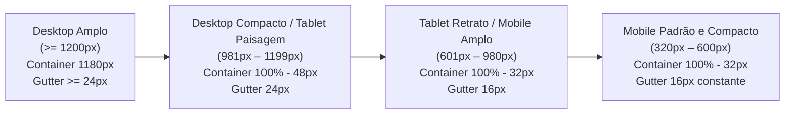
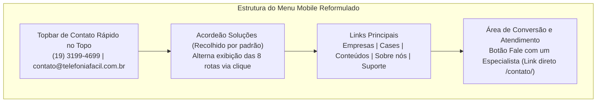
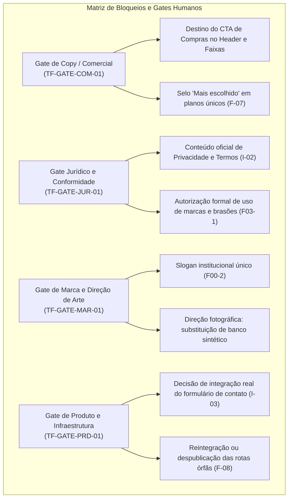

# Plano Transversal de Melhoria — Sistema Visual Compartilhado (28 Rotas)

| Metadado | Registro |
|---|---|
| **Projeto** | Site Institucional Telefonia Fácil (`2bx-systems/telefoniafacil`) |
| **Documento** | Plano Transversal de Sistema Visual, Consistência e Shell Compartilhado |
| **Auditorias de Origem** | [`docs/visual-audit-20261105/home.md`](../visual-audit-20261105/home.md), [`docs/visual-audit-20261105/products.md`](../visual-audit-20261105/products.md), [`docs/visual-audit-20261105/institutional.md`](../visual-audit-20261105/institutional.md) |
| **Planos Conexos** | [`docs/improvement-plans-20261105/home.md`](home.md), [`docs/improvement-plans-20261105/products.md`](products.md), [`docs/improvement-plans-20261105/institutional.md`](institutional.md) |
| **Cobertura Integral** | **28 rotas renderizadas**: Home (`/`), 12 Produtos/Soluções (`/0800/`, `/chip/`, `/empresas/`, `/equipamentos/`, `/integracoes/`, `/m2m/`, `/numero-fixo/`, `/pabx/`, `/planos/`, `/sip-trunk/`, `/telefonia-movel/`, `/ura/`), 15 Institucionais/Conversão (`/carrinho/`, `/checkout/`, `/compras/`, `/contratar/`, `/cases/`, `/contato/`, `/conteudos/`, `/parceiros/`, `/politica-de-privacidade/`, `/seguranca/`, `/sobre/`, `/solucoes/`, `/suporte/`, `/termos-de-uso/`, `/trabalhe-conosco/`) |
| **Base de Código** | Branch `feat/homepage-content-v2-draft`, HEAD `5c8cc8b` (com alterações locais de baseline) |
| **Responsável** | Dispatched Worker Antigravity — Orca Task `task_ba4f80f7352c`, Dispatch `ctx_1c35d9824fd6` |
| **Coordenador** | Terminal `term_ed80fe48-2439-45f4-8ec6-8898c35e988c` |
| **Data e Fuso** | 2026-11-05T19:25:00-03:00 |
| **Estado de Governança** | **Planejado / Proposta Técnica de Engenharia de Sistema**. Não é aceite de produto, aprovação de copy, validação comercial nem autorização para alterar staging/produção. Nenhum código foi modificado; nenhum texto legal, comercial ou factual foi alterado; nenhum destino de CTA foi desviado; compras legadas permanecem desativadas; nenhum teste, build, commit, push ou deploy foi executado. |

---

## 1. Síntese Executiva e Diretrizes de Sistema

A consolidação das três auditorias visuais independentes (`home.md`, `products.md`, `institutional.md`), cobrindo as **28 rotas** do Site Institucional Telefonia Fácil, revelou um núcleo técnico funcional (ausência de transbordo horizontal, tipografia Inter carregada via WOFF2 local, zero falhas no console JavaScript e CLS 0), mas fragmentado por uma **camada de apresentação dividida entre três lógicas concorrentes**:

1. **O Shell Global Legado (`assets/css/site.css` e `assets/js/site.js`):** Define tokens genéricos, um container de `1180px` com variações pontuais em `1120px`, um cabeçalho relativo que desaparece na rolagem, um rodapé com vocabulário divergente e botões com gradientes e sombras "glow" dos primórdios do projeto.
2. **A Direção Editorial da Home v2 (`assets/css/home-promo.css`):** Adotou um sistema refinado e austero de seções numeradas, títulos em dois tempos com final verde, tipografia escalonada por `clamp()`, remoção estrita de caixas com borda não-clicáveis e botões chapados sem elevação, criando um contraste estético drástico entre a Home e o restante do site.
3. **O Template Repetitivo de Produtos e Módulos Institucionais:** 8 das 12 páginas de produtos compartilham exatamente o mesmo bloco de 5 benefícios, mesmo aviso de compras, mesma introdução de FAQ e mesma faixa CTA, enquanto rotas institucionais sofrem colisões estruturais (H1 sobreposto a fotos em `/sobre/`, cards vazios em `/pabx/` e formulários sem endpoint real em `/contato/`).

### 1.1 Princípios Arquiteturais: Personalidade Coerente sem Monotonia de Template Único
O objetivo deste plano transversal **não é uniformizar todas as 28 páginas em um único template cinzento**, o que destruiria a intenção comercial e informativa de cada segmento. A engenharia do sistema deve fornecer um **chassi compartilhado rígido** (tokens de ritmo, container, acessibilidade, header, rodapé e botões) e **regras de composição flexíveis por famílias funcionais**:

- **Princípio da Coerência Estrutural:** Todas as 28 rotas devem obedecer às mesmas margens laterais (gutters), à mesma escala de tipografia para leitura de corpo e ao mesmo vocabulário de botões e links.
- **Princípio da Identidade por Família:** Uma página de infraestrutura de rede (`/sip-trunk/`, `/m2m/`) exige diagramas topológicos e conectores; uma página de hardware (`/equipamentos/`) requer catálogo técnico e fotografia nítida; uma página de produto de presença local (`/0800/`, `/numero-fixo/`) exige clareza de DDDs e ativação rápida; uma página de consumo pessoa física (`/chip/`) requer frescor e linguagem acessível; páginas de conformidade (`/politica-de-privacidade/`, `/termos-de-uso/`) exigem coluna contínua de alta legibilidade (65–75 caracteres por linha); e rotas de status/transição (`/compras/`, `/carrinho/`) exigem objetividade e encaminhamento consultivo.
- **Princípio da Não-Regressão Sistêmica:** Modificações nos arquivos compartilhados `assets/css/site.css` e `assets/js/site.js` possuem impacto universal nas 28 rotas. Nenhuma regra deve ser criada sem escopo delimitado ou sem verificação prévia de efeitos colaterais nas três classes de páginas (Home, Produtos e Institucionais).

---

## 2. Tokens Globais, Escala Tipográfica e Ritmo Vertical

O ecossistema atual possui inconsistências de declaração entre `:root` em `site.css` e as regras locais em `home-promo.css`. O sistema visual unificado padroniza os tokens centrais para consumo de todas as rotas.

### 2.1 Paleta Cromática Semântica e Garantia de Contraste WCAG AA
Os valores foram recalibrados para eliminar as falhas de contraste reportadas nas auditorias (F-14, I-07, I-19, T5):

```css
:root {
  /* Marca e Superfícies Escuras */
  --tf-navy:        #052b43; /* Navy institucional primário (fundo hero, cabeçalhos escuros) */
  --tf-navy-deep:   #03283c; /* Navy profundo (topbar, fechamento da Home, contrastes máximos) */
  --tf-navy-2:      #073a57; /* Navy intermediário (cards escuros, hovers de superfícies) */
  --tf-navy-3:      #0a4d69; /* Navy claro para realces em fundo escuro */

  /* Verdes de Marca e Ação */
  --tf-green:       #28e892; /* Verde primário da marca: uso exclusivo em botões primários e realces sobre Navy */
                             /* Contraste sobre --tf-navy: 9.49:1 (Supera WCAG AAA) */
  --tf-green-hover: #4fefa8; /* Verde clareado para estado hover de botões primários */
  --tf-green-text:  #0a7a4a; /* Verde escuro de texto: uso obrigatório para destaques de texto sobre fundo claro */
                             /* Substitui o problemático #0ca862. Contraste sobre #fff: 4.68:1 (Passa WCAG AA) */
                             /* Contraste sobre #f3f7fa (soft): 4.52:1 (Passa WCAG AA) */
  --tf-green-badge: #134e35; /* Fundo de selo sobre navy, combinado com texto --tf-green para contraste > 5:1 */

  /* Tipografia e Textos Neutros */
  --tf-ink:         #0a2740; /* Títulos e elementos de máximo contraste sobre fundo claro (12.8:1) */
  --tf-text-body:   #374957; /* Texto de corpo padrão: substitui o fraco #617586. Contraste sobre branco: 7.2:1 */
  --tf-muted:       #4c6171; /* Texto secundário, legendas e rótulos auxiliares (5.5:1 sobre branco) */

  /* Superfícies Claras e Divisores */
  --tf-surface-0:   #ffffff; /* Fundo base */
  --tf-surface-1:   #f4f8fa; /* Superfície suave alternada (section-soft) */
  --tf-surface-2:   #eaf2f5; /* Superfície neutra para fundos de imagem e caixas de dados */
  --tf-line:        #dbe6ed; /* Fio de borda sutil para separadores e tabelas */
  --tf-line-strong: #c6d6df; /* Fio de borda destacado (linhas corridas de seção) */

  /* Anéis de Foco Acessíveis */
  --focus-ring-light: #052b43; /* Anel de foco para fundos claros (contraste 11.3:1) */
  --focus-ring-dark:  #28e892; /* Anel de foco para fundos escuros (contraste 9.5:1) */
}
```

### 2.2 Escala Tipográfica Fluida e Resolução do Déficit de Corpo
A auditoria institucional (I-21) comprovou que **entre 27% e 62% de todos os caracteres renderizados no site encontravam-se abaixo de 13px**, com CTAs de cartões usando 12px (`detail-card a`, `.solution-content a`). A auditoria da Home apontou inversão hierárquica (preço de 72px vs H1 de 64px, F08-2).

A tipografia do sistema unifica a família `Inter` com as seguintes métricas fixas e fluidas:

| Token | Desktop (>=1024px) | Mobile (390px) | Line-height | Letter-spacing | Peso | Aplicação e Escopo |
|---|---|---|---|---|---|---|
| `--font-display` | `clamp(44px, 4.5vw, 64px)` | `38px` | `1.04` | `-0.035em` | 700 / 800 | H1 Home e Heróis Principais de Soluções |
| `--font-h2` | `clamp(32px, 3.5vw, 44px)` | `28px` | `1.10` | `-0.03em` | 700 | Títulos de Seção (nunca superior ao H1) |
| `--font-h3` | `clamp(22px, 2.2vw, 28px)` | `20px` | `1.25` | `-0.02em` | 600 | Títulos de Cartões e Subseções de Produto |
| `--font-h4` | `18px` | `17px` | `1.30` | `-0.01em` | 600 | Cabeçalhos de recursos e tópicos de lista |
| `--font-lead` | `clamp(16px, 1.3vw, 18px)` | `15px` | `1.55` | `normal` | 400 | Parágrafo de apoio imediato do hero |
| `--font-body` | `15px` | `14px` | `1.60` | `normal` | 400 | Texto corrido padrão em todas as 28 rotas |
| `--font-ui` | `14px` | `14px` | `1.00` | `normal` | 700 | Botões, CTAs e controles de formulário |
| `--font-caption` | `13px` | `12px` | `1.45` | `0` | 500 | Rodapé, metadados e notas de rodapé de planos |
| `--font-label` | `12px` | `11px` | `1.20` | `0.06em` | 700 | Sobretítulos (eyebrows) e tags em caixa-alta |

> [!IMPORTANT]
> **Piso Universal de Interação:** Fica estritamente proibido o uso de fontes menores que `14px` para elementos de ação direta (botões, links de conversão e campos de formulário). Textos de `12px` ficam restritos a metadados auxiliares de leitura passiva e prefixos monetários (`/mês`, `R$`).

### 2.3 Ritmo Vertical e Espaçamento Sistêmico
Os módulos de seção devem respeitar uma escala de respiração geométrica baseada em múltiplos de 8px:

```css
:root {
  --space-2xs: 4px;
  --space-xs:  8px;
  --space-sm:  12px;
  --space-md:  16px;
  --space-lg:  24px;
  --space-xl:  32px;
  --space-2xl: 48px;
  --space-3xl: 64px;
  --space-4xl: 96px;

  /* Respiros de Seção */
  --section-pad-y:       clamp(56px, 6vw, 96px); /* Padding vertical de seções de conteúdo */
  --section-pad-y-sm:    clamp(40px, 4vw, 64px); /* Seções de apoio e transição */
  --section-header-gap:  clamp(24px, 3vw, 44px); /* Espaço entre título de seção e grade */
}
```

---

## 3. Larguras, Containers, Gutters e Sincronização de Breakpoints

As auditorias demonstraram que o site sofre de **conflito de media queries**:
- `site.css:10` define `--container: min(1180px, calc(100% - 48px));` (gutter de 24px).
- `site.css:80` redefine `--container: calc(100% - 32px);` em `max-width: 980px` (gutter de 16px).
- `site.css:87` redefine `--container: calc(100% - 26px);` em `max-width: 600px` (gutter de 13px — excessivamente apertado).
- `site.css:133-134` e `182` codificam valores mágicos fixos como `1120px` (`calc((100% - 1120px)/2)`).
- `site.css:912` introduz um breakpoint de colapso de menu em `1120px`, enquanto o restante do layout colapsa em `980px`, criando uma faixa cinzenta de `140px` (entre 980px e 1120px) com comportamentos híbridos imperfeitos.

### 3.1 Normalização Arquitetural dos Containers
O sistema transversal unifica os containers e gutters em 4 patamares responsivos claros:



```css
/* Definição de Container em site.css */
:root {
  --container-max: 1180px;
  --container-gutter: 24px;
  --container: min(var(--container-max), calc(100% - (var(--container-gutter) * 2)));
}

@media (max-width: 980px) {
  :root {
    --container-gutter: 16px;
    --container: calc(100% - (var(--container-gutter) * 2));
  }
}

/* Eliminar o gutter excessivamente colado de 13px em 600px: manter 16px constante */
@media (max-width: 600px) {
  :root {
    --container-gutter: 16px;
    --container: calc(100% - 32px);
  }
}
```

### 3.2 Correção do Alinhamento do Logo com o Grid (F01-6, F-18, I-22)
O arquivo de imagem `assets/images/logo-telefonia-facil.png` possui 6px de transparência morta no lado esquerdo. Em consequência, enquanto os títulos e grids alinham rigorosamente em `x = 130px` (desktop de 1440px), o primeiro pixel visível do logo inicia em `x ≈ 136px`. No mobile (390px), o grid inicia em `x = 13px` e o logo em `x ≈ 18px`.

**Solução transversal mandatória:**
- Recomenda-se a migração definitiva para arquivo vetorial `logo-telefonia-facil.svg` com caixa delimitadora aparada nos limites da tinta.
- Como contingência imediata no CSS transversal (`site.css`):
```css
.brand img, .footer-logo {
  margin-left: -6px; /* Compensa o respiro transparente mantendo o alinhamento de 130px exatos no desktop */
}
@media (max-width: 980px) {
  .brand img {
    margin-left: -5px; /* Compensa alinhamento em viewports mobile e tablet */
  }
}
```

---

## 4. Tipos de CTA, Hierarquia Visual e Botões do Sistema

A auditoria da Home (F01-4) e das Institucionais (I-04, I-08) registrou a coabitação de **dois sistemas visuais de botões inconciliáveis**:
1. **O botão do header:** `linear-gradient(135deg, var(--tf-green), #17d984)`, sombra difusa `0 12px 28px rgba(40,232,146,.2)`, elevação `translateY(-2px)` no hover, corpo `13px/800`, altura `44px`.
2. **Os botões de conteúdo (Home v2):** Verde chapado `#28e892`, sem gradiente, sem sombra, sem elevação mecânica, corpo `14px/700`, altura `48px`.

### 4.1 Unificação do Sistema de Botões e CTAs
O sistema transversal adota uma única anatomia de componentes para as 28 rotas:

```
┌────────────────────────────────────────────────────────────────────────┐
│                        ANATOMIA DE BOTÕES DO SISTEMA                   │
├───────────────────┬────────────────────────────────────────────────────┤
│ Primário          │ Fundo: #28e892 (chapado) | Texto: #043347 (700)    │
│ (.btn-primary)    │ Hover: #4fefa8 (sem translateY, sem glow verde)    │
│                   │ Altura: 48px (desktop) / 44px (header e mobile)    │
├───────────────────┼────────────────────────────────────────────────────┤
│ Secundário Claro  │ Fundo: transparente | Borda: 1px sólida #acc1ce   │
│ (.btn-outline)    │ Texto: #052b43 (700) | Hover: #f4f8fa borda #052b  │
├───────────────────┼────────────────────────────────────────────────────┤
│ Secundário Escuro │ Fundo: rgba(255,255,255,.04) | Borda: rgba(fff,.4) │
│ (.btn-dark-outline)│ Texto: #ffffff | Hover: rgba(255,255,255,.10)     │
├───────────────────┼────────────────────────────────────────────────────┤
│ Link de Ação      │ Fundo: nenhum | Texto: #0a7a4a (700)               │
│ (.btn-link)       │ Alvo de toque expandido via padding invisível >=44 │
└───────────────────┴────────────────────────────────────────────────────┘
```

### 4.2 A Regra de Ouro: Um Único Primário por Dobra Visual (F01-2, F-05, I-04)
Atualmente, a primeira dobra da Home e de várias páginas de produto apresenta **dois botões verdes primários com destinos e intenções concorrentes**:
- No Header: "Acessar Página de Compras" (verde, para `/compras/`).
- No Hero: "Falar com o nosso time" ou "Contratar esta solução" (verde, para `/contato/` ou `/compras/`).

**Regra mandatória do sistema visual:**
1. **Nunca exibir dois botões com estilo `.btn-primary` na mesma dobra visível.**
2. O botão de ação primária do header deve adotar estilo secundário/neutro (`.btn-outline`) durante a navegação normal, deixando o destaque cromático verde reservado ao objetivo principal da seção em foco.
3. **Desativação de Compras:** Enquanto o fluxo legado de compras estiver desativado por governança institucional, a rota `/compras/` é meramente informativa. Não conceder o botão primário mais pesado do site a um fluxo em preparação.

### 4.3 Faixa CTA Final (`.cta` / `footer()`): Modularização por Contexto
O componente `<aside class="cta">`, gerado por `site.js:29`, atualmente injeta em 11 rotas institucionais e 8 de produtos exatamente o mesmo texto comercial: *"Encontre a solução adequada à sua empresa... A nova experiência de compras está em preparação."* (F-05, I-09). Isso faz com que páginas técnicas, de suporte (`/suporte/`) e termos legais (`/termos-de-uso/`) encerrem com um aviso descontextualizado de compras.

**Solução transversal por perfis:**
- **Perfil Comercial/Produto:** Exibe a faixa com fechamento navy (`.section-dark`), chamada consultiva e botão para `/contato/`.
- **Perfil Institucional/Corporativo (`/sobre/`, `/cases/`):** Exibe chamada de parceria com tom institucional.
- **Perfil Funcional/Suporte (`/suporte/`):** Exibe bloco focado nos canais de atendimento direto (telefone e e-mail), sem menção a carrinho de compras.
- **Perfil Legal e Status (`/politica-de-privacidade/`, `/termos-de-uso/`, `/compras/`, `/carrinho/`):** Omissão da faixa CTA, concluindo a página diretamente no rodapé padronizado.

---

## 5. Shell Compartilhado: Header, Navegação Global, Menu Mobile e Rodapé

### 5.1 Posicionamento do Cabeçalho e Retenção do Visitante (F01-5, F-18, I-22)
O header possui regra conflitante: é declarado como `position: sticky; top: 0` na linha 26 de `site.css`, mas imediatamente desativado na linha 98 com `.header { position: relative; background: #fff; backdrop-filter: none; }`.
Em páginas longas como a Home (9.060px no mobile), `/planos/` (15.225px no mobile) ou `/sobre/` (6.444px), o visitante que rola perde completamente o menu, telefone e canal de contato.

**Estratégia transversal aprovada:**
- Restabelecer o cabeçalho fixo compacto (`position: sticky; top: 0; z-index: 90;`) com altura contida (entre `60px` e `64px` na rolagem), fundo translúcido `rgba(255,255,255,0.95)` com `backdrop-filter: blur(12px)` e borda inferior sutil de `1px solid var(--tf-line)`.
- No mobile, o cabeçalho fixo preserva o botão de menu e o acesso imediato ao telefone de contato.

### 5.2 Limpeza das Redundâncias de Navegação do Header (F01-1, F-18, S2)
O cabeçalho atual exibe 7 entradas com redundâncias gritantes em apenas 880px úteis:
- Link "Soluções" (abre dropdown com 8 itens) e botão "Ver soluções" (leva a `/solucoes/`).
- Link "Página de Compras" (texto colado a 10px de "Ver soluções") e botão "Acessar Página de Compras" (verde, dominante).

**Normalização da estrutura do header:**
1. Manter uma única entrada para Soluções, combinando o clique no rótulo ou na seta para abrir o dropdown, com um rodapé interno no menu apontando para "Ver todas as soluções (`/solucoes/`)".
2. Reduzir a presença de Compras a um único link secundário discreto (sujeito à decisão do Gate de Copy), eliminando a duplicidade.
3. Padronizar o espaçamento entre itens de navegação em `24px` a `28px`, e isolar a área de ações da direita com margem esquerda de respiro mínima de `32px`.

### 5.3 Menu Mobile: Acesso a Contato e Acordeão de Soluções (F00-1, F01-8, I-05)
No mobile (`<= 980px`), a `topbar` é ocultada pelo CSS. No entanto, o `mobile-menu` atual:
- Não contém nenhum número de telefone nem e-mail.
- Lista as 8 soluções permanentemente expandidas com borda verde lateral, ocupando `770px` da tela e empurrando os links institucionais e o botão de ação para fora da primeira vista do usuário.
- O botão hambúrguer possui `outline: 0!important` e `box-shadow: none!important` em `site.css:916-917`, impedindo a navegação por teclado e foco visível (F-16, I-06).

**Reestruturação transversal do menu mobile:**


### 5.4 Rodapé Compartilhado: Vocabulário, Dados Societários e Rotas Faltantes (F11-2 a F11-6, F-19, I-22, I-23)
O rodapé institucional gerado por `site.js:29` apresenta divergências graves em relação ao restante do site:
- **Vocabulário divergente:** O header usa "Cases", o rodapé usa "Clientes"; o header usa "SIP Trunk", o rodapé usa "E1 e SIP Trunk".
- **Rotas órfãs excluídas:** As páginas `/seguranca/`, `/parceiros/` e `/trabalhe-conosco/` não constam nas colunas do rodapé.
- **Inconsistência de telefonia:** O rodapé exibe o 0800 ("0800 999 3199"), enquanto a topbar exibe o número de Campinas sem DDD informado no rodapé ("(19) 3199-4699").
- **Divergência de Slogans (F00-2):** A topbar afirma *"Comunicação que aproxima negócios"*; o rodapé afirma *"Conexões que impulsionam o seu negócio."*. A definição de slogan único depende do Gate de Marca.

---

## 6. Acessibilidade Transversal: Foco Teclado, Contraste WCAG AA e Alvos de Toque

### 6.1 Correção dos Anéis de Foco (`:focus-visible`)
A conformidade WCAG 2.1 AA exige que todo elemento operável por teclado apresente indicador de foco inequívoco com taxa de contraste mínima de 3:1 contra o fundo adjacente.

1. **Remoção de Resets Destrutivos:** Excluir imediatamente `outline: 0!important;` e `box-shadow: none!important;` das regras `.hamb:hover, .hamb:focus, .hamb:focus-visible` em `site.css:916-917` (F-16, I-06).
2. **Sistema Bipolar de Anel de Foco:**
   - Em superfícies claras: anel duplo ou deslocamento com cor `--tf-navy` (`#052b43`, 2px de espessura, 2px de offset).
   - Em superfícies escuras (Navy): anel com cor `--tf-green` (`#28e892`, 2px de espessura, 2px de offset).
   - O skip link existente (`.skip-link`, `x: 8, y: -82`) opera corretamente ao receber foco via Tab, devendo ser preservado rigorosamente.

### 6.2 Alvos Mínimos de Toque (Touch Targets >= 44×44px)
A auditoria identificou controles com área de toque inferior ao padrão de acessibilidade mobile (WCAG 2.5.5 / 2.5.8):
- Links da topbar medem 18px de altura no desktop (F-18).
- Itens de FAQ no `/chip/` medem 30px de altura (F-14).
- Sublinks do menu mobile medem 37px de altura em alguns nós (I-34).
- Links do rodapé em `12px` com espaçamento reduzido.

**Regra mandatória do sistema:** Todo elemento clicável ou acionável por toque deve garantir área reativa mínima de `44×44px` (seja por dimensão intrínseca do elemento, seja por expansão transparente com padding ou pseudo-elementos `::after`).

---

## 7. Princípios por Família: Personalidade Coerente sem Uniformização Monótona

O site não pode ser pasteurizado em um único modelo de blocos empilhados. Cada família declarada no objeto `PAGE_FAMILIES` de `site.js:403` desempenha um papel cognitivo diferente na jornada do cliente:

```
                              MAPA DE FAMÍLIAS DO SITE
                                         │
        ┌────────────────────────────────┼────────────────────────────────┐
        ▼                                ▼                                ▼
  FAMÍLIAS DE PRODUTO          FAMÍLIAS INSTITUCIONAIS            FAMÍLIAS DE TRANSIÇÃO
  • presence (0800, Fixo)      • manifesto (Sobre)                • status (Compras,
  • platform (PABX, URA)       • wall (Cases)                       Carrinho, Checkout,
  • network (SIP, M2M)         • editorial (Conteúdos)              Contratar)
  • field (Móvel, Equipam.)    • stage (Contato)                  • legal (Privacidade,
  • pricing (Planos)           • desk (Suporte)                     Termos de Uso)
  • ladder (Empresas)          • vault (Segurança)
  • hubline (Integrações)      • split / roster (Parceiros/Vagas)
  • consumer (Chip)
```

### 7.1 Diretrizes de Composição por Família de Produto
1. **Presença Local (`presence` — `/0800/`, `/numero-fixo/`):**
   - Foco na expansão geográfica da empresa.
   - Recursos apresentados em lista limpa acompanhada por mapa ou visual de alcance nacional.
   - Tabela de DDDs e ativação rápida em destaque.
2. **Plataforma e Central Telefônica (`platform` — `/pabx/`, `/ura/`):**
   - Foco no fluxo das chamadas e automação.
   - Substituição obrigatória dos 4 cards vazios do PABX (F-02) por módulos de casos de uso tipográficos estruturados (sem fotos quebradas de 134×94px).
   - Diagrama de fluxo de ramais, filas e atendimento automatizado.
3. **Conectividade e Rede (`network` — `/sip-trunk/`, `/m2m/`):**
   - Foco em robustez técnica, estabilidade e capacidade simultânea de canais.
   - Diagramação com linhas de interconexão entre o data center do cliente e a operadora.
   - Eliminação do card de plano único esmagado em 540px (F-01).
4. **Campo e Hardware (`field` — `/telefonia-movel/`, `/equipamentos/`):**
   - Foco em mobilidade de equipes e equipamentos homologados.
   - Catálogo estruturado por categorias de aparelhos (telefones IP, headsets corporativos, ATAs).
5. **Consumo / Pessoa Física (`consumer-page` — `/chip/`):**
   - Preservação da voz própria, mais dinâmica e direta.
   - Correção do carrossel no mobile (reintroduzir imagem do chip em proporção adequada e ajustar alvos de toque do FAQ).

### 7.2 Diretrizes de Composição Institucional e Legal
1. **Manifesto (`manifesto` — `/sobre/`):**
   - Ritmo editorial solene, apoiado na história, solidez e estrutura física da empresa.
   - Resolução da colisão entre o H1 e a imagem do hero (I-01).
2. **Páginas Legais (`legal` — `/politica-de-privacidade/`, `/termos-de-uso/`):**
   - Tipografia contínua em coluna única de largura controlada (`65ch` a `75ch`), índice de âncoras na lateral ou topo, data formal de vigência e supressão da faixa comercial de vendas.
   - Retenção do status até deliberação do Gate Jurídico (I-02).
3. **Páginas de Transição e Status (`status` — `/compras/`, `/carrinho/`, `/checkout/`, `/contratar/`):**
   - Layout limpo, sem formulários ou botões falsos de fechamento de pedido.
   - Mensagem clara e transparente de que as compras online passam por renovação sistêmica, fornecendo canal consultivo imediato via WhatsApp ou telefone.

---

## 8. Regras de Mídia Responsiva e Eliminação de Defeitos de Renderização

### 8.1 Correção dos Bloqueios Críticos de Renderização Identificados

#### A. O Colapso dos Cards de Plano Único (F-01)
- **Problema:** Em `/m2m/`, `/pabx/`, `/sip-trunk/`, `/telefonia-movel/` e `/ura/`, o layout desktop (>= 981px) força a grade `.plans` a 4 colunas horizontais (`1.1fr .7fr 1fr auto`, `site.css:525-531`), enquanto `site.css:944` restringe a largura total a `max-width: 540px`. O preço (157px de texto) é espremido em uma coluna de apenas 39px, transbordando visualmente e colidindo com a lista de benefícios e o botão.
- **Correção Transversal:** Remover a restrição artificial de `540px` da regra de plano único em `site.css:944`, permitindo que o card ocupe a largura completa do container (`--container`), espelhando a implementação bem-sucedida de `/planos/`.

#### B. Colisão do H1 com Imagem em `/sobre/` (I-01)
- **Problema:** O título H1 termina em `x = 808px` e a foto da equipe inicia em `x = 763px`, sobrepondo a palavra "resultados" em 45px na resolução de 1440px. A falha é causada pela regra herdada de `site.css:691` (`left: 53%`), que não é cancelada pelo media query de `site.css:951` que tenta aplicar `right: 0` com `width: max(...)`.
- **Correção Transversal:** Inserir `left: auto!important;` na regra `.family-hero-photo` do seletor `body[data-family="manifesto"] .page-hero` em `site.css:951`. Isso libera o posicionamento pela direita, assegurando folga mínima de 38px a 60px para o texto em todas as larguras de tela (1024px a 1920px).

#### C. Quebra de Coluna Dupla no Mobile em `/numero-fixo/` (F-03)
- **Problema:** No mobile (390px), a regra `.plans:has(> :last-child:nth-child(2))` em `site.css:943` posiciona-se após os blocos de media query de 980px e 600px, reabrindo forçosamente duas colunas de 173px lado a lado. O preço fica imprensado e o botão do plano quebra em duas linhas.
- **Correção Transversal:** Envolver a regra de linha 943 com `@media (min-width: 601px)`, garantindo que em larguras mobile a grade de planos permaneça estritamente em coluna única (`grid-template-columns: 1fr`).

#### D. Desaparecimento de Imagens no Mobile (`.hero-media{display:none}`) (F-04)
- **Problema:** A regra de `site.css:214` oculta sistematicamente `.hero-media` e `.hero-benefits` em telas menores que 980px nas 8 rotas de produtos e no Chip, substituindo imagens por GIFs vazios de 1×1px. A dobra de entrada de 9 produtos torna-se 100% idêntica no smartphone, descaracterizando a solução.
- **Correção Transversal:** Eliminar a ocultação indiscriminada de mídia. Em telas pequenas, a imagem do hero deve ser reposicionada abaixo do texto de abertura, com proporção controlada (`aspect-ratio: 16/10`), cantos arredondados (`border-radius: 12px`) e carregamento via `srcset` para evitar sobrecarga de dados em rede móvel.

---

## 9. Matriz Integral de Cruzamento de IDs, Screenshots e Duplicações

A tabela a seguir cruza rigorosamente todos os achados transversais e compartilhados das três auditorias, mapeando as evidências visuais registradas nos arquivos de captura e indicando as sobreposições entre os planos:

| ID Transversal | ID Home | ID Produtos | ID Institucional | Evidência em Screenshot (Caminho Real no Ambiente) | Diagnóstico Visual Concreto | Natureza da Duplicação / Relação entre Planos |
|---|---|---|---|---|---|---|
| **SYS-01** | F01-1, F01-2 | F-05, F-18 | S2, I-04 | `shots/d2-header.png`, `audit/out/solucoes.desktop.fold.png` | Duplicidade "Página de Compras" + "Acessar Página de Compras" e "Soluções" + "Ver soluções" | **Duplicata Tripla Integral.** Origem única em `site.js:28` e `site.css:28-40`. Resolvida no shell transversal. |
| **SYS-02** | F01-4, T6 | F-18 | S2, I-08 | `st/focus-foot.png`, `st/focus-callout.png`, `shots/d2-header.png` | Botão do header com gradiente/glow vs botões do conteúdo planos | **Duplicata Tripla.** Inconsistência de token de botão entre shell global e conteúdo v2. |
| **SYS-03** | F01-6 | F-18 | S5, I-22 | `shots/d-fold.png`, `st/w1440.png`, `audit/out/sobre.desktop.fold.png` | Logo desalinhado em 6px à direita do grid de conteúdo | **Duplicata Tripla.** Respiro transparente no PNG compartilhado `logo-telefonia-facil.png`. |
| **SYS-04** | F00-1, F01-8 | F-18 | S1, S2m, I-05 | `st/m-menu.png`, `st/m-menu-full.png`, `audit/out/contato.mobile.fold.png` | Topbar oculta no mobile sem transferir telefone/e-mail para o menu mobile | **Duplicata Tripla.** Falha estrutural de retenção do usuário mobile em todas as 28 rotas. |
| **SYS-05** | F01-7 | F-16 | I-06 | `st/m-menu.png`, `shots/chip.m.fold.jpg`, `audit/out/contato.mobile.fold.png` | Botão hambúrguer com `outline:0!important`, foco por teclado invisível | **Duplicata Dupla.** Regra universal em `site.css:916-917` afeta todas as 28 rotas. |
| **SYS-06** | F01-5 | F-18 | S2, I-22 | `st/d-scrolled.png`, `st/m-scrolled.png`, `audit/out/solucoes.desktop.full.png` | Header relativo desaparece na rolagem em páginas de mais de 6.000px | **Duplicata Tripla.** Sobrescrita indevida de `position: sticky` por `position: relative` em `site.css:98`. |
| **SYS-07** | F10-1, F11-1 | F-05, F-14 | S4, I-09 | `shots/d-s06.png`, `shots/0800.d.full.jpg`, `audit/out/suporte.desktop.full.png` | Faixa CTA final com texto idêntico e aviso de compras em preparação em 19 rotas | **Duplicata Tripla.** Componente rígido em `footer()` de `site.js:29`. Exige modularização. |
| **SYS-08** | F00-2, F11-2 a F11-6 | F-19 | S5, I-22, I-23 | `shots/d-full.png`, `shots/ura.d.full.jpg`, `audit/out/sobre.desktop.full.png` | Rodapé com vocabulário divergente do header, rotas faltantes e corpo 12px | **Duplicata Tripla.** Componente de rodapé compartilhado em `site.js:29` e `site.css:75-90`. |
| **SYS-09** | T5, F02-4 | F-14 | I-07, I-19 | `st/focus-offer.png`, `shots/pabx.d.full.jpg`, `audit/out/conteudos.desktop.full.png` | Falhas de contraste WCAG AA: `#0ca862` (3.09:1) e selo verde sobre navy (2.16:1) | **Duplicata Tripla.** Invalidação de tokens em `site.css`. Correção única no `:root`. |
| **SYS-10** | T1, T2 | F-17 | I-21 | `shots/d-full.png`, `shots/planos.d.full.jpg`, `audit/out/cases.desktop.full.png` | Déficit de corpo tipográfico: excesso de texto abaixo de 13px e falta de escala | **Duplicata Tripla.** Falta de escala tipográfica unificada em variáveis CSS no `:root`. |
| **SYS-11** | T8 | F-01, F-03 | I-18 | `shots/m-s00.png`, `shots/numero-fixo.m.full.jpg`, `st/w320.png` | Gutter mobile inconsistente (13px vs 16px) e media queries não sincronizados | **Duplicata Tripla.** Descompasso entre 1120px, 980px e 600px no CSS base. |
| **SYS-12** | T7, T9 | F-08 | I-12 | `data.json` de varredura de links (25 rotas auditadas) | Três rotas de produto órfãs (`/planos/`, `/empresas/`, `/integracoes/`) e 3 institucionais | **Intersecção Sistêmica.** Governança de arquitetura de informação e roteamento global. |
| **SYS-13** | — | F-01 | — | `scratch_ura_plan.png`, `shots/ura.d.full.jpg`, `shots/m2m.d.full.jpg` | Card de plano único quebrado em 540px com texto de preço sobreposto a itens | **Específico de Produtos.** Afeta 5 rotas (`/m2m/`, `/pabx/`, `/sip-trunk/`, `/telefonia-movel/`, `/ura/`). |
| **SYS-14** | — | F-02 | — | `scratch_pabx_use.png`, `shots/pabx.d.full.jpg` | Quatro cards em branco (380px vazios) na seção 2 do PABX | **Específico de Produtos.** Erro de dados no JS e CSS de imagem. |
| **SYS-15** | — | F-03 | — | `scratch_nf_plans_m.png`, `shots/numero-fixo.m.full.jpg` | Grade de planos forçada em duas colunas no mobile de 390px no Número Fixo | **Específico de Produtos.** Falha na ordem de media queries em `site.css:943`. |
| **SYS-16** | F08-3 | — | — | `shots/m-s07.png` | Fio horizontal do link de oferta quebrado e curto no mobile | **Específico da Home.** Regra de borda em `home-promo.css`. |
| **SYS-17** | — | — | I-01 | `scratch_sobre_full_hero.png`, `audit/out/sobre.desktop.full.png` | Colisão física do H1 com a foto em `/sobre/` (sobreposição de 45px) | **Específico de Institucional.** Regra de posicionamento relativo em `site.css:951`. |

---

## 10. Critérios de Aceite Verificáveis (Desktop e Mobile por Componente)

Para que qualquer modificação no sistema visual seja considerada concluída, as condições objetivas abaixo devem ser comprovadas via render e inspeção de DOM:

### 10.1 Cabeçalho e Navegação (Header)
- **Desktop (1440px / 1280px / 1024px):**
  - O cabeçalho mantém altura entre `60px` e `74px` e permanece visível de forma contínua durante toda a rolagem com fundo translúcido e desfoque ativo.
  - Apenas um link/botão para Compras existe no cabeçalho; não há repetição simultânea de "Página de Compras" e "Acessar Página de Compras".
  - O botão primário do cabeçalho não compete visualmente com o hero: adota visual neutro/secundário quando a primeira dobra já possui um primário verde.
  - O primeiro pixel do logo alinha rigorosamente com o texto de abertura abaixo (`x = 130px` em 1440px).
- **Mobile (390px / 360px / 320px):**
  - O botão hambúrguer exibe caixa delimitadora com foco visível nítido (`outline` contrastante de 2px) quando ativado via Tab ou toque.
  - O painel mobile exibe atalhos diretos para ligação telefônica (`tel:+551931994699`) e envio de mensagem/e-mail no topo da navegação.
  - O grupo de Soluções abre como acordeão retrátil, permitindo visualizar os links institucionais sem necessidade de rolagem excessiva.

### 10.2 Botões e Ações de Conversão
- **Desktop e Mobile:**
  - Todo botão primário (`.btn-primary`) possui fundo sólido `--tf-green` (`#28e892`), texto contrastante `--tf-navy` (`#043347`, 700), sem sombras "glow" fluorescente ou translações mecânicas verticais.
  - Na primeira dobra visível de qualquer uma das 28 rotas, existe **no máximo um elemento com estilo de botão primário**.
  - Todo elemento interativo possui alvo de toque reativo de no mínimo `44×44px`.

### 10.3 Contêineres, Quebras e Cartões Críticos
- **Desktop (1440px a 981px):**
  - O card de plano único em `/m2m/`, `/pabx/`, `/sip-trunk/`, `/telefonia-movel/` e `/ura/` ocupa a largura do container, com preço, benefícios e botão dispostos com folga visual mínima de `24px` entre colunas, com zero transbordo de texto.
  - Em `/sobre/`, a foto da equipe preserva distância livre de pelo menos `38px` em relação à última letra do título H1 em todas as resoluções entre 981px e 1920px.
  - Em `/pabx/`, os 4 cards da seção de cenários apresentam fundo neutro estruturado com tipografia legível e sem qualquer espaço vazio decorrente de imagens ausentes.
- **Mobile (390px a 320px):**
  - Em `/numero-fixo/`, os cartões de plano organizam-se rigorosamente em coluna única vertical (`1fr`), garantindo largura livre total para leitura de preço e recursos sem compressão lateral.
  - As margens laterais do container em toda a extensão do site respeitam o padrão contínuo de `16px` de respiro em relação à borda da tela.

### 10.4 Rodapé Compartilhado
- **Desktop e Mobile:**
  - O vocabulário das colunas reflete fielmente o cabeçalho (adotando "Cases" e "SIP Trunk").
  - As páginas institucionais `/seguranca/`, `/parceiros/` e `/trabalhe-conosco/` constam nas colunas correspondentes de navegação.
  - O texto dos links e direitos autorais adota corpo mínimo de `13px` com taxa de contraste mínima de `5.5:1` em relação ao fundo.

---

## 11. Arquitetura de Execução: Análise da Ordem de Edição Mais Segura

Uma das decisões de engenharia mais sensíveis deste ciclo de evolução consiste em determinar a sequência cronológica de edição: **o Plano Transversal do Sistema deve ser editado PRIMEIRO ou DEPOIS dos planos específicos de rota (Home, Produtos, Institucionais)?**

### 11.1 Por que o Plano Transversal DEVE Ser Executado Primeiro
A análise técnica da árvore de dependências do repositório demonstra categoricamente que **o Plano Transversal deve ser executado PRIMEIRO**, pelas seguintes razões de arquitetura:

1. **Evitar o Efeito Dominó de Regressão em Cascata:**
   - Se os planos locais forem implementados primeiro, cada desenvolvedor ou agente ajustará margens, paddings, tamanhos de fonte e quebras de linha com base nas regras globais atuais de `site.css`.
   - Se o Plano Transversal for aplicado posteriormente, modificações nas variáveis globais (`--container`, `--space-*`, tokens de cor, escala tipográfica e media queries do header) invalidarão instantaneamente os alinhamentos finos conquistados nas páginas locais, forçando um retrabalho massivo de re-calibração nas 28 rotas.
2. **Resolução Imediata de 60% dos Achados Globais em Um Único Ponto de Edição:**
   - A correção do respiro do logo (SYS-03), a restauração do foco do hambúrguer (SYS-05), a sincronização dos media queries de colapso (SYS-11), a recalibração do contraste do verde escuro (SYS-09) e a unificação do vocabulário do rodapé (SYS-08) são realizadas exclusivamente em `assets/css/site.css` e `assets/js/site.js`.
   - Ao editar o sistema transversal primeiro, todas as 28 rotas são imediatamente beneficiadas e desobstruídas antes do início dos trabalhos específicos de página.
3. **Isolamento e Redução de Complexidade nos Planos de Rota:**
   - Uma vez que o chassi compartilhado (tokens, gutters, header fixo, tipografia base e botões) estiver firme e verificado, os planos locais da Home, Produtos e Institucionais podem concentrar-se exclusivamente em seu escopo de conteúdo e módulos específicos (ex.: diagramas de produto, tabela de ofertas da Home, formulário de contato), sem risco de conflito com o shell.

```
                    ORDEM CRONOLÓGICA DE EXECUÇÃO RECOMENDADA
                                         │
 ┌───────────────────────────────────────┴───────────────────────────────────────┐
 │ FASE 1: NÚCLEO TRANSVERSAL (site.css e site.js) [PRIMEIRO]                    │
 │ 1.1 Inserção dos Tokens Globais e Recalibração Cromática no :root             │
 │ 1.2 Sincronização dos Containers, Gutters (16px/24px) e Media Queries         │
 │ 1.3 Remoção do outline:0 do hambúrguer e padronização dos anéis de foco      │
 │ 1.4 Unificação do Componente de Botões (.btn-primary plano, sem glow)         │
 │ 1.5 Correção do Header Fixo (sticky) e limpeza de duplicidades no menu        │
 │ 1.6 Correção dos Defeitos Críticos Globais de CSS (F-01, F-03, I-01)          │
 └───────────────────────────────────────┬───────────────────────────────────────┘
                                         │
 ┌───────────────────────────────────────┴───────────────────────────────────────┐
 │ FASE 2: DESDOBRAMENTO ESPECÍFICO POR PLANO DE ROTA [DEPOIS]                   │
 │ 2.1 Execução do Plano de Produtos: Módulos autênticos e cards vazios PABX     │
 │ 2.2 Execução do Plano de Institucionais: Casos, Contato e Enquadramentos      │
 │ 2.3 Execução do Plano da Home: Diagramação v2, Prova Social e Ofertas         │
 └───────────────────────────────────────┬───────────────────────────────────────┘
                                         │
 ┌───────────────────────────────────────┴───────────────────────────────────────┐
 │ FASE 3: RE-AUDITORIA INTEGRADA E CONFERÊNCIA FINAL NAS 28 ROTAS               │
 └───────────────────────────────────────────────────────────────────────────────┘
```

---

## 12. Matriz de Riscos, Dependências e Gates de Decisão

A execução deste plano não autoriza alterações arbitrárias em matérias reservadas a deliberação dos owners humanos. Cada dependência é categorizada na matriz abaixo:



### 12.1 Mapeamento Detalhado dos Gates

| Código do Gate | Responsável Recomendado | Achados Conexos | Impacto no Sistema Visual Transversal | Condição de Retomada |
|---|---|---|---|---|
| **TF-GATE-COM-01** | Owner Comercial / Copy | F01-1, F-05, I-04, F-07 | Define o rótulo e papel do link de compras enquanto a nova experiência de compras está desativada. | Aprovação do texto substitutivo para CTAs do header e fechamento. |
| **TF-GATE-JUR-01** | Jurídico / DPO | I-02, I-16, F03-1 | Impede que as rotas legais e prova social exibam textos internos de rascunho ou logos sem chancela. | Envio das minutas jurídicas finais e autorização de clientes. |
| **TF-GATE-MAR-01** | Marca / Direção de Arte | F00-2, F02-1, F-10, I-30 | Unifica os dois slogans divergentes do site e define os ativos proprietários da Telefonia Fácil. | Definição da assinatura oficial e fornecimento do logo SVG limpo. |
| **TF-GATE-PRD-01** | Owner de Produto | I-03, F-08, I-12 | Delibera sobre a conexão de um backend real para `/contato/` ou reformulação do fluxo `mailto:`. | Decisão de arquitetura para captação de leads institucional. |

---

## 13. Conclusão e Próximos Passos

Este plano transversal entrega o mapeamento geométrico, visual e arquitetural necessário para harmonizar as **28 rotas** do Site Institucional Telefonia Fácil. Ele estabelece uma ponte sólida entre a direção editorial premium da Home v2 e o ecossistema de produtos e páginas institucionais, sem rebaixar a diversidade das páginas a um padrão engessado e genérico.

Nenhum arquivo de código foi alterado durante a elaboração deste documento, em estrito cumprimento às instruções de governança de `AGENTS.md`. A implementação prática das diretrizes aqui registradas aguarda a autorização do coordenador e a deliberação dos gates humanos competentes.
